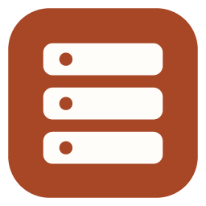
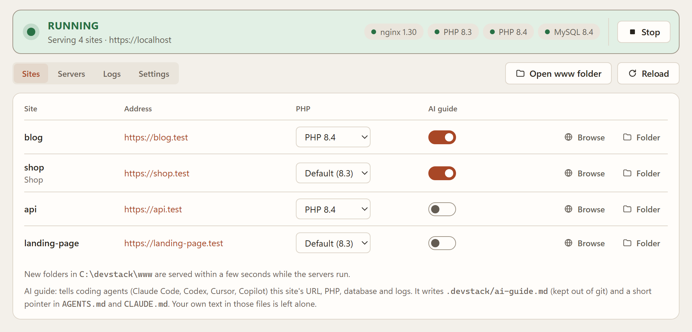

<p align="center">
  <a href="https://devstack.holostack.in">
    
  </a>
</p>

<h1 align="center">devstack</h1>

<p align="center">
  <b>Every project folder, served.</b><br>
  nginx, PHP and MySQL for Windows. Drop a folder into <code>www</code> and it's live at <code>name.test</code>
  seconds later, on the PHP version it needs, over trusted HTTPS.
</p>

<p align="center">
  <a href="https://github.com/harsha2805/devstack/releases/latest"></a>
  <a href="https://github.com/harsha2805/devstack/releases"></a>
  <a href="LICENSE"></a>
  
  
  <a href="https://github.com/sponsors/harsha2805"></a>
</p>

<p align="center">
  <a href="https://devstack.holostack.in/download"><b>⬇️ Download for Windows</b></a>
  &nbsp;·&nbsp;
  <a href="https://devstack.holostack.in/download/portable">Portable zip</a>
  &nbsp;·&nbsp;
  <a href="https://devstack.holostack.in">Website</a>
  &nbsp;·&nbsp;
  <a href="https://devstack.holostack.in/changelog">Changelog</a>
</p>

<p align="center">
  <picture>
    <source media="(prefers-color-scheme: dark)" srcset="website/public/img/dashboard-dark.png">
    
  </picture>
</p>

## ✨ Highlights

<table>
  <tr>
    <td width="50%" valign="top">
      <h3>📂 Drop a folder, get a site</h3>
      Every folder in <code>www</code> is served at <code>name.test</code> within seconds, subdomains included.
      Projects kept elsewhere join with <b>Add folder</b>. No hosts file, no vhost to write.
    </td>
    <td width="50%" valign="top">
      <h3>🐘 PHP per project</h3>
      Run PHP 8.1 to 8.5 side by side and pick one per site. In any terminal, <code>php</code> and
      <code>composer</code> follow the site you're in.
    </td>
  </tr>
  <tr>
    <td valign="top">
      <h3>🔒 Trusted HTTPS</h3>
      A local certificate authority Windows trusts, limited to local names. No browser warnings, no admin
      rights.
    </td>
    <td valign="top">
      <h3>🗄️ MySQL and SQL Server</h3>
      MySQL with a generated password, and Microsoft's <code>sqlsrv</code> / <code>pdo_sqlsrv</code> for every
      PHP version in one command.
    </td>
  </tr>
  <tr>
    <td valign="top">
      <h3>🤖 AI guide</h3>
      Tells Claude Code, Codex, Cursor and Copilot how each site runs here: URL, PHP, database, logs and
      what not to touch.
    </td>
    <td valign="top">
      <h3>🛡️ Verified and private</h3>
      Servers come from their publishers, checked against pinned SHA-256 hashes. Signed updates, no telemetry.
    </td>
  </tr>
</table>

## 🚀 Install

Download `devstack_setup_<version>.exe` from **[devstack.holostack.in](https://devstack.holostack.in)** and run
it. It installs for your account only (no admin prompt) into `%LOCALAPPDATA%\Programs\devstack`, adds `devstack`
to your PATH, and puts devstack's `php` and `composer` first. The first launch asks where your sites should live
and which PHP and MySQL versions to run, then downloads and starts them.

> [!NOTE]
> devstack isn't code-signed yet, so Windows may say "Windows protected your PC" the first time. Choose
> **More info → Run anyway**. Each release's `SHA256SUMS.txt` lists the files' hashes, and every release is built
> and tested by GitHub Actions from a tagged commit ([release.yml](.github/workflows/release.yml)).

The app checks for updates once a day and installs one only when you click **Update now** (Settings → Updates).
Uninstalling keeps your stack folder with its sites and databases. Prefer no installer? Take the
[portable zip](https://devstack.holostack.in/download/portable).

## 🖥️ Desktop app

`devstack-app.exe` lives in the tray. Left-click opens the dashboard; closing the window keeps it running in the
tray; "Stop servers and quit" ends everything. Choosing a folder that already has a `stack.toml` adopts that stack.

- **Sites:** click a name to open its folder, an address to open it in the browser, pick its PHP version, switch
  its AI guide on, or open a terminal there with its PHP ready.
- **Servers:** services, the database login, PHP extensions (SQL Server), and versions to install or remove.
- **Logs** and **Settings:** start servers with the app, open at sign-in, `.test` addresses, HTTPS, updates.

It is plain HTML/CSS/JS served on 127.0.0.1 behind a per-launch token and shown in a WebView2 window; without
WebView2 it opens in the browser.

## ⌨️ Command line

```powershell
devstack init        # downloads nginx/PHP/MySQL (sha256-verified), picks free ports, writes stack.toml + www\hello
devstack pkg list    # available and installed server versions
devstack pkg install php 8.3
devstack pkg install ext sqlsrv pdo_sqlsrv   # SQL Server for PHP (php.net builds leave it out)
devstack up          # renders etc\ and starts everything in the background
devstack status
devstack sites       # URLs, e.g. http://hello.localhost:8080
devstack project add E:\clients\acme   # serve a folder outside www, as acme (--name to pick; also: remove, list)
devstack reload      # after editing stack.toml (folders in www\ are picked up on their own)
devstack logs nginx -f
devstack db creds    # generated MySQL root password
devstack dns on      # <site>.test addresses for every program (one admin prompt; off / status)
devstack https on    # trusted HTTPS for every site (Windows asks once; off / status)
devstack guide add   # AI guide for coding agents in the current site's folder (also: remove, show)
devstack terminal hello   # PowerShell in a site's folder; php and composer run its PHP
devstack shims       # is devstack's php first on PATH? (`shims fix` puts it there)
devstack doctor
devstack down
```

`devstack up --foreground` runs in the terminal instead (Ctrl+C stops everything).

Servers are downloaded on demand from their publishers (windows.php.net, nginx.org, cdn.mysql.com) and checked
against the SHA-256 pins in `internal/packages/catalog.json`. To reuse builds you already have, pass
`init --bin D:\laragon\bin`. devstack runs alongside other local stacks, and `init` moves to free ports when 80
and 3306 are taken.

## 🐘 PHP and Composer in terminals

`php` and `composer` in any terminal run the PHP of the site you're in, with devstack's `php.ini` and extensions,
so `php artisan migrate` or `composer install` match what the site is served with:

```powershell
cd D:\devstack\www\shop; php -v     # PHP 8.5, because shop runs on 8.5
cd ..\blog; composer install        # PHP 8.3 for blog
$env:DEVSTACK_PHP = "8.4"; php -v   # force one version
```

Setup puts devstack's `shims` folder (`php.exe`, `composer.exe`) first on your PATH. They read the site list
devstack writes on every reload, so changing a site's PHP in the app changes it in terminals too. `composer` runs
a pinned Composer (SHA-256 checked), downloaded the first time you use it.

> [!TIP]
> Another PHP on the **system** PATH (Laragon, XAMPP, a Composer-Setup install) comes before every user PATH
> entry. The sites list then says so and **Fix** moves devstack's first (one administrator prompt);
> `devstack shims fix` does the same. The terminal icon on each site opens PowerShell there with the right PHP
> either way.

## 🌐 .test addresses

Sites always answer at `http://<name>.localhost`, which needs no setup but only works in browsers and curl:
Windows itself doesn't resolve `*.localhost`, so PHP, Postman and most CLI tools can't reach it. Turning on
**.test addresses** (Settings, the one-time question on the Sites tab, or `devstack dns on`) fixes that:

- Windows asks for administrator approval once, to add a Name Resolution Policy rule that sends only `*.test`
  lookups to `127.0.0.1`. Nothing else changes: real domains are never affected, and hosts-file entries
  (Laragon's, for example) still win.
- While the servers run, devstack answers those lookups itself, so every site and subdomain
  (`api.my-app.test`) works the moment its folder appears. There is no hosts file to edit per site.
- `stack.toml` records it as `services.dns = "on"`, and site URLs switch to `<name>.test`. Turning it off
  removes the rule again (one more prompt).

## 🔒 HTTPS

Turn on **HTTPS** in Settings (or `devstack https on`) and every site also answers at `https://`, with a
certificate Windows trusts: Edge, Chrome, curl.exe and PowerShell show no warnings. Plain `http://` keeps working.

- devstack makes a certificate authority for your Windows account in `%LOCALAPPDATA%\devstack\ca`, and Windows asks
  you once to trust it. No administrator rights are needed.
- The CA can only sign local names: `*.localhost`, your TLD (`*.test`) and loopback addresses. Even a stolen CA
  key can't produce a certificate for a real website.
- Each site gets its own certificate (`name.test`, `*.name.test`, `name.localhost`, `*.name.localhost`), reissued
  when its names change and before it expires. New folders get one automatically.
- The landing page publishes the CA's empty revocation list, so strict Windows clients (curl.exe) can finish
  their revocation check.
- PHP, Node and Python keep their own trust lists. From code, call the `http://` address, or point the tool at
  `ca.crt`. The AI guide tells agents the same.
- Port 443 is used unless another program holds it; then devstack picks 8443 or another free port.
- Turning HTTPS off, or uninstalling devstack, removes the CA from Windows and deletes it.

## 🤖 AI guide

AI coding agents don't know how a project runs on this machine, so they guess: the wrong `php`, a php.ini-less
PHP without extensions, `artisan serve` next to a site that is already served, database settings from nowhere.
The **AI guide** switch on each site (or `devstack guide add`) fixes that:

- `.devstack/ai-guide.md` gets this machine's details: site URL, the exact PHP build and how to run it and
  Composer with the stack's php.ini, extensions that didn't load, the database `.env` points at and whether its
  driver is loaded, log files, devstack commands, and what not to touch. The folder ignores itself in git, and
  devstack rewrites the guide on every start and reload, so it follows PHP version, port and path changes.
  Passwords are never written; it says to run `devstack db creds`.
- `AGENTS.md` (read by Codex, Cursor, Copilot and others) gets a short pointer to that file, and `CLAUDE.md`
  imports `AGENTS.md` for Claude Code. Both are safe to commit. devstack only edits between its
  `<!-- devstack:begin -->` markers, and turning the guide off removes exactly what it added.

## 🗂️ Layout

| Path | What |
|---|---|
| `stack.toml` | the only config you edit |
| `www\<site>\` | projects; `.devstack.toml` inside one overrides docroot, PHP version, aliases |
| `[projects]` in `stack.toml` | project folders kept outside `www`, by the name each is served under |
| `etc\` | generated config, rewritten on every render; don't edit |
| `etc-custom\nginx\*.conf` | your own nginx config, included and never touched |
| `etc-custom\php\8.3\php.ini` | your own settings for every site on PHP 8.3, added to the end of the generated php.ini (Servers > php.ini) |
| `data\` | MySQL data, daemon state, `secrets.toml` |
| `logs\` | `devstack.log`, `nginx-error.log`, `php-8.3-error.log`, `mysql.log`, `sites\*.access.log` |

### PHP settings

Sites on the same PHP version share one php.ini, as in Laragon or Herd. Change settings at the level you need:

| For | Where | Applies |
|---|---|---|
| one site | `.user.ini` in the site's docroot (`public\` for Laravel) | within seconds, no reload |
| every site on one PHP version | Servers > **php.ini** (`etc-custom\php\<version>\php.ini`) | PHP restarts when you save |
| every PHP version | `[php.ini]` in `stack.toml` | after Reload |

`.user.ini` covers per-site settings like `memory_limit`, `upload_max_filesize`, `post_max_size` and
`max_execution_time`. Extensions and opcache are set per PHP version.

## 🛠️ Build from source

Requires Go 1.27+.

```powershell
.\build.ps1 -Version 0.1.0     # dist\devstack.exe (CLI), dist\devstack-app.exe (tray + window), dist\shims\
go test ./...
```

- [docs/SPEC.md](docs/SPEC.md): design and roadmap · [docs/PLAN.md](docs/PLAN.md): how it is built
- [docs/RELEASING.md](docs/RELEASING.md): releases (installer, portable zip, signed update feed)
- [docs/WEBSITE.md](docs/WEBSITE.md): the website at devstack.holostack.in, a small Laravel app in [`website/`](website/)
- [CHANGELOG.md](CHANGELOG.md): what changed in each version

devstack is a clean-room project, designed from observable behavior and the public documentation of the
servers it runs. No code, templates or assets from closed-source tools are used.

## 🔐 Privacy

devstack has no telemetry. It connects to the internet only to check for updates once a day
(`https://devstack.holostack.in/latest.json`, sending just its version; turn it off in Settings → Updates), to
download an update from GitHub when you click Update now, and to download nginx, PHP, MySQL and Composer from
their publishers when you install them. Details: [devstack.holostack.in/privacy](https://devstack.holostack.in/privacy).

## ⭐ Star history

<a href="https://www.star-history.com/#harsha2805/devstack&Date">
  <picture>
    <source media="(prefers-color-scheme: dark)" srcset="https://api.star-history.com/svg?repos=harsha2805/devstack&type=Date&theme=dark">
    
  </picture>
</a>

## 📄 License

[Apache License 2.0](LICENSE), by Harsha ([HoloStack](https://holostack.in)). Use it, change it and ship it, in
open or closed projects. If you redistribute devstack or a modified version, keep the [NOTICE](NOTICE) file with
its credit and say what you changed. Releases up to 0.2.5 were published under the MIT license.

The license covers the code, not the name: a fork you distribute should go by its own name and logo, not
"devstack".

devstack downloads nginx (BSD), PHP (PHP License), MySQL (GPLv2) and Composer (MIT) from their publishers at run
time; none of them are bundled.

<p align="center">
  <sub>Made by <a href="https://github.com/harsha2805">Harsha</a> · <a href="https://holostack.in">HoloStack</a>
  · <a href="https://github.com/sponsors/harsha2805">Sponsor the work ❤️</a></sub>
</p>
